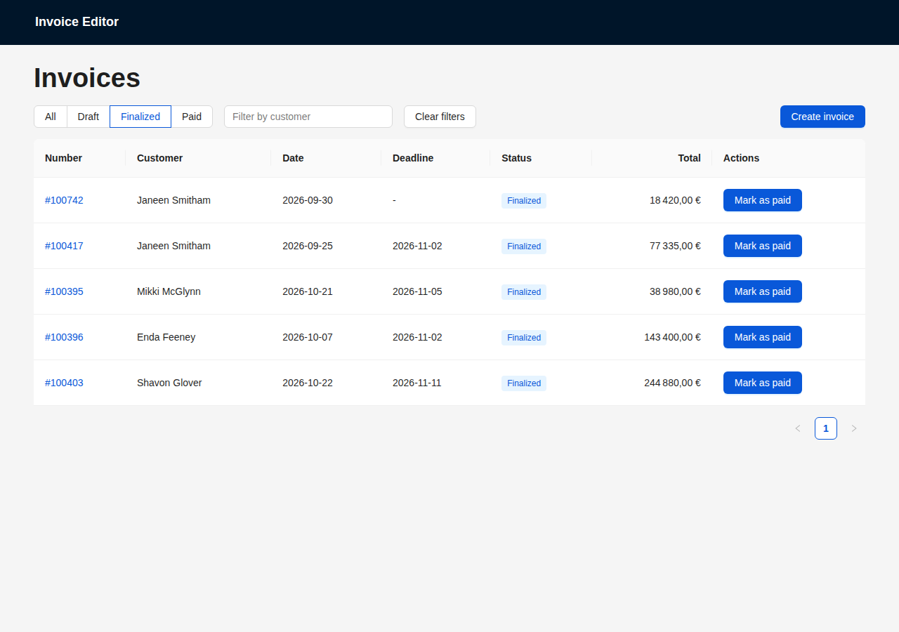
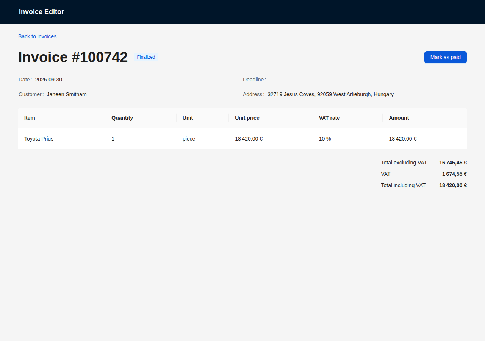
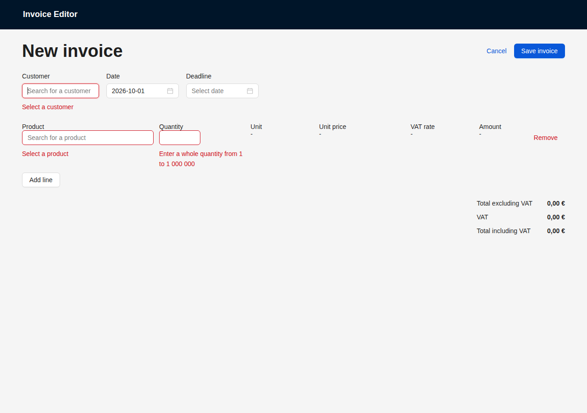
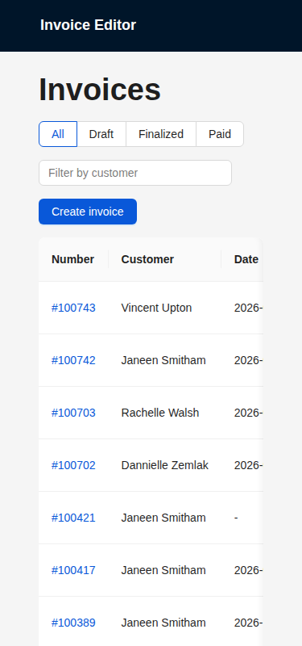
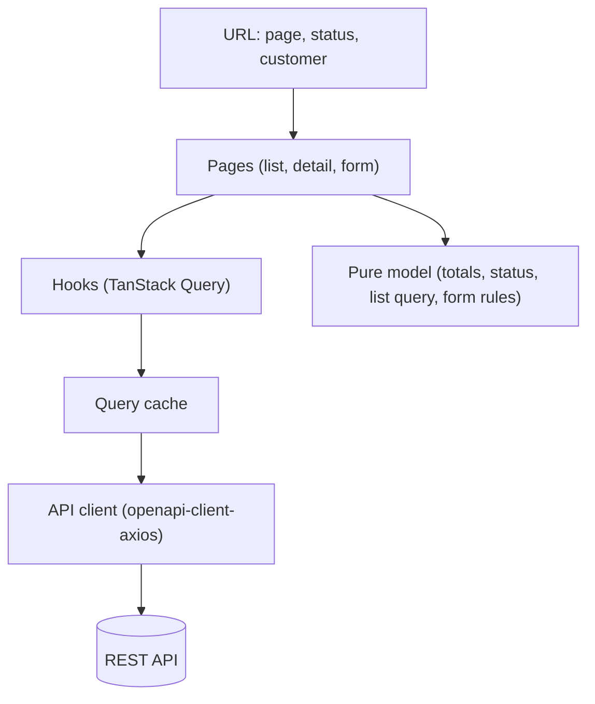
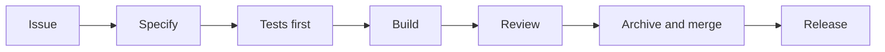

# Invoice editor

A prototype invoice editor for small businesses: list, view, create, edit,
finalize, delete and mark invoices as paid, on top of an existing REST API.
There is no backend of its own; every figure comes from the API or is derived
from it in the browser.

- **Improvement ideas and trade-offs:** [NOTES.md](NOTES.md)

## Screenshots

| List with a status filter and a customer filter                               | Invoice detail, finalized                                                       |
| ----------------------------------------------------------------------------- | ------------------------------------------------------------------------------- |
|  |  |

| Creation form with validation messages                                                      | List at 375 px                                                            |
| ------------------------------------------------------------------------------------------- | ------------------------------------------------------------------------- |
|  |  |

## Features

The core requirements are a list, a creation page, an edit page and a show page, plus
finalizing and deleting invoices.

- **List** every invoice with its number, customer, date, deadline, status and
  total, ten per page, with server-side pagination.
- **Filter** the list by status (All, Draft, Finalized, Paid) and by customer.
  Both filters live in the URL, so a filtered list can be shared or bookmarked.
- **View** an invoice: its details, its lines (label, quantity, unit, unit
  price, VAT rate, amount) and its totals excluding VAT, VAT and including VAT.
- **Create** an invoice from a form: a customer, a date, an optional deadline
  and one or more lines, each a product and a quantity.
- **Edit** a draft invoice, changing its fields and its lines.
- **Finalize** a complete draft, **delete** a draft, and **mark** a finalized
  invoice as paid or unpaid.

What was added beyond the core requirements:

- **Client-side validation** that covers the gaps the API leaves open: a whole
  quantity from 1 to 1 000 000, a deadline not before the date, a date, at
  least one line, and a customer. A draft that breaks one of these rules cannot
  be finalized, because a finalized invoice can no longer be edited or deleted.
- **A retry rule**: a failed request is retried once, and never after a client
  error such as "not found".
- **Exact money**: amounts are decimal strings and are summed with `big.js`;
  a number is never used for money end to end.
- **Loading, empty and error states** for every request, with accessible names
  on the controls and a layout that does not scroll sideways on a phone.

## Requirements

- Node and yarn at the versions pinned in `.tool-versions` (Node 24.12.0, yarn
  1.22.22)
- An API token for the REST API

## Run locally

Create `.env.local` at the repository root (git-ignored; the tracked `.env`
holds only a placeholder):

```sh
VITE_API_TOKEN=<your token>
```

Then:

```sh
yarn install
yarn start
```

## Test and verify

```sh
yarn test      # unit and component tests
yarn verify    # format check, lint, typecheck, tests, build
yarn verify:pr # run verify on the pushed branch and post the output on its pull request (needs gh)
yarn format    # fix formatting
```

## Deploy

The app is hosted on Cloudflare Pages and deployed manually with the pinned
`wrangler` CLI. Both commands refuse to run without `VITE_API_TOKEN` configured.

```sh
npx wrangler login     # once per machine
yarn deploy:preview    # from a branch: https://preview.invoice-editor.pages.dev
yarn deploy            # from main, after merge: https://invoice-editor.pages.dev
```

The preview uses the same production build and the same API, so actions tested
there change real data.

## Architecture

The application is a single-page React app. Data flows in one direction: a page
asks a hook for data, the hook reads the query cache or the API, and the page
renders what it gets back. The URL is the source of truth for the list state.



Layers, and the rule each one follows:

| Layer   | Location      | Rule                                                             |
| ------- | ------------- | ---------------------------------------------------------------- |
| Pages   | `src/pages`   | Compose the UI; they do not fetch directly                       |
| UI      | `src/ui`      | Reusable components, such as the invoice form and the actions    |
| Hooks   | `src/hooks`   | Data fetching and shared logic with TanStack Query               |
| Model   | `src/model`   | Pure TypeScript domain logic, no React                           |
| API     | `src/api`     | The generated client (`src/api/gen` is generated) and query keys |
| Helpers | `src/helpers` | Formatting: amounts, rates, names, addresses                     |
| Tests   | `src/specs`   | Test setup, MSW server and fixtures                              |

Project structure:

```
src/
  App.tsx     layout and route table (data-mode router)
  main.tsx    providers: API, query client, toasts, theme
  theme.ts    accessible color overrides for the antd theme
  api/        API client (src/api/gen is generated) and query keys
  hooks/      data fetching with TanStack Query
  model/      pure domain logic: totals, status, URL parameters, invoice form rules (no React)
  pages/      one folder per route; pages compose, they do not fetch directly
  ui/         reusable components (`ui/InvoiceForm`: the invoice form, shared by the creation and edit pages; `ui/InvoiceActions`: the finalize, delete and paid actions)
  helpers/    formatting helpers
  specs/      test setup, MSW server, fixtures
```

Money stays a decimal string from the API to the screen: sums use `big.js` and
formatting uses `Intl.NumberFormat` on the string, never a floating-point
number.

## Key decisions and trade-offs

Every entry links to the design note that argues it, with the alternatives that
were rejected. The full set lives in the archived change folders under
`openspec/changes/archive/`.

- **The URL is the state of the list** (page, status, customer): a filtered
  list is shareable and the browser back button works.
  [02](openspec/changes/archive/2026-09-29-02-add-invoices-list/design.md),
  [07](openspec/changes/archive/2026-09-30-07-add-list-filters/design.md)
- **Totals are derived from the lines**, not read from the invoice: the seeded
  invoices store no totals, and their stored tax disagrees with the server's own
  formula.
  [02](openspec/changes/archive/2026-09-29-02-add-invoices-list/design.md)
- **One query hook per resource, with a key factory**, and a retry rule that
  retries once and never after a 4xx.
  [02](openspec/changes/archive/2026-09-29-02-add-invoices-list/design.md),
  [03](openspec/changes/archive/2026-09-29-03-add-invoice-detail/design.md)
- **The router is in data mode with a layout route**, so the header stays while
  a page loads or fails, and one `InvoiceLoader` holds the shared loading, not
  found and error states.
  [03](openspec/changes/archive/2026-09-29-03-add-invoice-detail/design.md),
  [05](openspec/changes/archive/2026-09-30-05-add-invoice-edit/design.md)
- **Forms in react-hook-form with a yup schema**, and a payload built only from
  the validated values.
  [04](openspec/changes/archive/2026-09-30-04-add-invoice-create/design.md)
- **Editing a line's product deletes and recreates the line**: the API keeps the
  old label, price and VAT when only `product_id` changes on a saved line, which
  two experiments showed.
  [05](openspec/changes/archive/2026-09-30-05-add-invoice-edit/design.md)
- **One actions component for the list and the detail page**, confirmations, a
  finalize blocker, and an optimistic update for the paid flag only.
  [06](openspec/changes/archive/2026-09-30-06-add-invoice-lifecycle/design.md)
- **Filters are built and parsed in a pure module**, so the URL grammar and the
  exact API filter strings are tested without React.
  [07](openspec/changes/archive/2026-09-30-07-add-list-filters/design.md)
- **Accessibility**: a theme override for color contrast, tables and the form
  grid that scroll inside their own container on narrow screens, and a
  top-level heading on every page.
  [08](openspec/changes/archive/2026-10-01-08-add-release-documentation/design.md)
- **No CI**: checks run locally, so `yarn verify:pr` runs them on the pushed
  head and posts the output on the pull request.
  [01](openspec/changes/archive/2026-09-28-01-add-project-foundation/design.md)

## Testing approach

Tests use Jest, React Testing Library, `user-event` and MSW. There are 345 of
them.

- **Unit tests** for the pure logic in `src/model` and `src/helpers`: totals,
  VAT, status, URL parameters, form rules and payloads, error mapping.
- **Page tests** that drive the UI as a user would (typing, clicking, tabbing)
  with the network mocked by MSW, covering the loading, empty, error and success
  state of every request.
- **By role and accessible name**, never by CSS class, so a test fails when a
  control loses its label, not when a class changes.
- **Every spec scenario is mapped to a test or to a manual check** in the pull
  request's scenario-to-test table, because a few behaviors (the real host, the
  antd calendar keyboard, the screen reader) cannot be observed in jsdom.

Run them with `yarn test`.

## How it was built

The project follows a specification-first loop, with test-first development
inside each feature. The loop is the same for every change.



1. **Plan**: a fixed roadmap with one GitHub issue per pull request. New ideas
   found while building go to `NOTES.md`, not into the current change.
2. **Specify**: every change is an OpenSpec change (proposal, spec delta with
   Given/When/Then scenarios, design with the alternatives rejected, tasks with
   how each is verified). The specification is approved before any code.
3. **Test first**: each scenario becomes at least one test before the code
   exists; the tests are run and seen failing for the right reason, then the
   code is written until they pass.
4. **Build**: small conventional commits; `yarn verify` passes before each one.
5. **Review**: every line read and understood; `yarn verify:pr` posts the
   verification output for the exact head commit, and the preview deployment is
   checked by hand against the live API.
6. **Archive and merge**: the change is archived as the last commit, folding its
   spec delta into `openspec/specs/`; the pull request is squash merged, which
   closes its issue.
7. **Release**: `yarn deploy` to production and the same checks on the
   production URL.

Where each step leaves evidence:

| Step              | Artifact                                                              |
| ----------------- | --------------------------------------------------------------------- |
| Plan              | GitHub issues                                                         |
| Specify           | `openspec/changes/archive/<change>/` (proposal, specs, design, tasks) |
| Test first        | The failing-then-passing tests in the diff                            |
| Build             | Conventional commits, each green under `yarn verify`                  |
| Review            | The `verify:pr` comment on the pull request                           |
| Archive and merge | `openspec/specs/` and the squash merge on `main`                      |
| Release           | The production URL and the deploy in Cloudflare                       |

One feature end to end, the list filters:

1. The issue asks for filters on the list.
2. The change
   [`07-add-list-filters`](openspec/changes/archive/2026-09-30-07-add-list-filters/)
   specifies them: status and customer, kept in the URL, with "Clear filters"
   and an empty-filter state.
3. A scenario such as "Clear both filters" becomes a test in
   `src/pages/InvoicesList/index.spec.tsx` before the code.
4. The code adds `src/model/listQuery.ts` (pure, unit-tested) and the controls
   in the list page.
5. The pull request carries the scenario-to-test table and the `verify:pr`
   comment; the preview is checked by hand.
6. The change is archived and squash merged, then deployed.

This repository is a single import commit, so the original red/green runs and
the per-pull-request history are not visible here. The archived change folders
keep the scenarios, designs and tasks that drove each feature.

## AI usage

AI assistants wrote a large part of this codebase, under the specification-first
loop described above. The tools used:

| Tool        | Model              | Used for                                                                 |
| ----------- | ------------------ | ------------------------------------------------------------------------ |
| Claude Code | Claude Opus 5.5    | Planning and architecture: specification changes, designs, review passes |
| Claude Code | Claude Sonnet 5.5  | Implementation: tests from the scenarios, code, documentation drafts     |
| OpenCode    | DeepSeek 4.1 Flash | Implementation                                                           |
| OpenSpec    | (not an AI model)  | Structure and lifecycle of the specification changes                     |

The controls are the same whatever the tool: the specification is approved
before any code, tests come from its scenarios, `yarn verify` gates every
commit, every line is reviewed, and the preview deployment is checked by hand
before merge. `CLAUDE.md` holds the conventions given to the assistants.

Two examples of AI output corrected during review:

- The customer picker kept its search after a selection, so clearing a filter
  left it listing only that customer. It was found by hand on the preview, not
  by the tests, and fixed in the shared component with a regression test.
- The first edit design updated saved invoice lines in place. Two experiments
  against the API showed the server then keeps wrong labels and VAT, so the
  design changed to delete and recreate a changed line, with the evidence
  written into the design.

## Dependency changes from the starter

Runtime dependencies are unchanged from the starter. Removed as unused:

- `react-table`: the tables use antd.
- `babel.config.cjs`, `@babel/preset-env`, `babel-plugin-transform-import-meta`:
  the Jest `transform` sends every source file to `ts-jest`, which does not read
  the Babel configuration.

Development dependencies added, each justified in the foundation change design:
`eslint`, `@eslint/js`, `typescript-eslint`, `eslint-plugin-react-hooks`,
`globals` and `wrangler`.

## Known limitations

These are the main gaps; each one, with what led to it and what is missing, is
in [NOTES.md](NOTES.md).

- The API token is visible in the deployed bundle, because the browser calls the
  API directly; a backend or an edge function would be needed to hide it.
- Deployments are manual and there is no CI: checks run locally and are posted
  on the pull request.
- The API validates little, so the client carries the rules; another client of
  the same API can still store or finalize an incomplete invoice.
- No unsaved-changes guard on the forms, and concurrent edits are last-write-wins.
- No column sort and no date range filter on the list.
- Payment is a single flag: no date, amount or method; credit notes are not
  modeled.
- Classic Cloudflare Pages, which is being merged into Workers.

## Specifications

Changes are specified with [OpenSpec](https://github.com/Fission-AI/OpenSpec)
before they are implemented: `openspec/specs/` holds the current behavior,
`openspec/changes/` the changes in progress.
